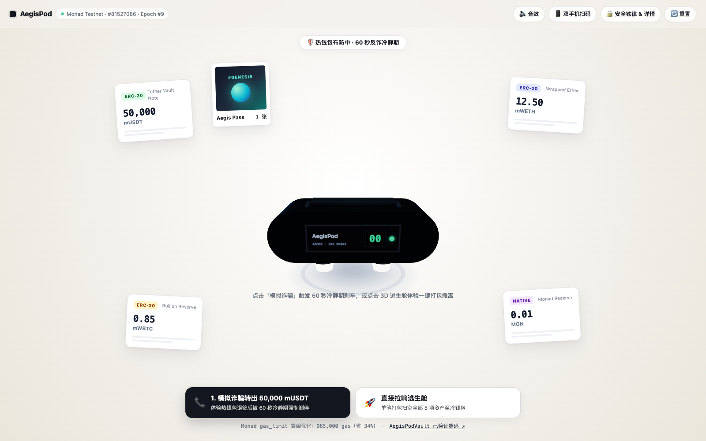

# AegisPod — 反诈冷静期与多资产逃生舱

为 Monad Blitz@广州（Event #18）构建的 Monad Testnet 原型。资产存入合约金库后，风险转出先进入冷静期；发现风险时，钱包主人或守护人可以冻结金库、使旧队列失效，并把登记资产转到预设冷钱包。

- **在线体验：** https://monad.sxlx.tech
- **配音演示视频（2 分 35 秒）：** [下载 / 观看 MP4](https://github.com/RSXLX/aegispod/releases/download/v1.0.0/AegisPod-demo-zh-CN.mp4)
- **演示素材：** [Release](https://github.com/RSXLX/aegispod/releases/tag/v1.0.0) · [中文解说稿](docs/narration.zh-CN.md) · [字幕](docs/narration.zh-CN.srt)
- **网络：** Monad Testnet，chain ID `10143`
- **合约：** [`0x0026acd0077d7518d51c654887d1e9a19789b23a`](https://testnet.monadscan.com/address/0x0026acd0077d7518d51c654887d1e9a19789b23a)



## 解决的问题

诈骗来电、钓鱼诱导和钱包主人密钥泄露，都可能导致误签转账。AegisPod 把“转出请求”和“实际执行”分开，为守护人争取响应时间；需要整体撤离时，将风险隔离和多资产转移放在同一次合约调用中。

保护对象是**存入 AegisPodVault 的资产**，不是任意外部钱包中的全部余额。

## 功能与合约机制

1. **链上冷静期：** 只有守护人批准的白名单地址且金额未超阈值，才可直接转出。其他原生币或 ERC-20 请求进入队列；当前部署为 60 秒。到期后仍需 Owner 主动执行，不会自动转账。
2. **单笔取消与整体逃生：** Owner 或 Guardian 可取消单笔队列请求，也可调用 `triggerEscapePod` 触发整体保护。
3. **冻结与队列换代：** 逃生先设置 `frozen`，并执行 `epoch += 1`。旧请求因版本不匹配而失效，队列失效步骤为 O(1)，无需逐条删除。
4. **多资产清单：** 处理 Native MON、已登记 ERC-20、ERC-721 和调用者补充清单。ERC-20 存款和安全转入的 ERC-721 可自动登记，资产转移仍逐项执行。
5. **权限边界：** Guardian 无普通转出权限；Guardian 和逃生目的地址在部署后不可修改；Owner 只能延长冷静期、降低原生币阈值。白名单由 Guardian 管理。
6. **双人恢复：** 冻结后，Owner 与 Guardian 必须分别确认才能解冻。
7. **可视化演示：** Three.js 逃生舱、资产卡片、链上回执链接和二维码角色页面，展示风险转账到资产撤离的完整过程。

**转移语义：** 一笔交易批量处理不等于对所有代币提供无条件的“全成或全败”保证。异常 ERC-20 / NFT 使用尽力转移策略，部分资产可能被跳过；必须结合事件和资产余额核验结果。该原型尚未经过独立安全审计。

## Monad 与技术实现

- Solidity `0.8.28`、OpenZeppelin `ReentrancyGuard` 和资产接口。
- 前端为 HTML / CSS / JavaScript + Three.js；服务端为 Node.js / TypeScript + viem。
- 状态读取通过 Multicall 聚合；交易优先尝试 `eth_sendRawTransactionSync`，不可用时回退普通广播和回执轮询。
- 发送前使用 `estimateGas`，加约 12% 和固定缓冲；资产清单估算作为兜底。节省比例随资产登记数量和链上估算变化，不能当作固定收益。
- 演示记录的延迟是应用发送到收到回执的耗时，包含网络与 RPC 开销，不是链共识终局时间保证。

## 实际演示证据

| 操作 | 交易 |
| --- | --- |
| 五万枚 mUSDT 陌生转出进入冷静期 | [查看回执](https://testnet.monadscan.com/tx/0x208992c3b0a6a726472d45958713af0f75731d2f37cc63f2dad6ce688dc986dd) |
| 触发逃生舱 | [查看回执](https://testnet.monadscan.com/tx/0x636f732b95f54a1b3ae936ed1a823102b8274e2fd2cd1c8fc0cb12f8051acd9c) |

录制后核对：金库冻结，MON、mUSDT、mWETH、mWBTC 与 NFT 展示余额为零，诈骗演示地址 mUSDT 余额为零。详细回执见 [transactions.json](docs/evidence/transactions.json)。这是该次测试的结果。

## 运行与复现

需要 Node.js 22+ 与 pnpm。仓库包含现有测试网部署地址，不包含私钥。

```bash
cd contracts
pnpm install --frozen-lockfile
pnpm compile
cd ../web
pnpm install --frozen-lockfile
pnpm typecheck
pnpm dev
```

打开 `http://localhost:3000` 可读取现有测试网状态。要操作**你自己的演示部署**：

1. 参考 `contracts/.env.example` 准备独立测试账户，或运行 `pnpm setup:wallets` 创建演示账户，并取得测试 MON。
2. 在 `contracts/` 中运行 `pnpm deploy:testnet`，生成你自己的 `deployments.json`。
3. 启动 web 服务。交易按钮从服务端环境读取测试账户私钥，不要求浏览器连接钱包。
4. `pnpm test:security` 对当前部署执行只读 RPC 模拟检查；它依赖测试网和有效演示配置，不是独立的本地测试套件。
5. `pnpm demo:smoke` 会发送测试网交易并改变该部署状态，只对自己的演示部署运行。

## 评委体验路径

打开在线页面 → 必要时点“重置”准备资产 → “模拟诈骗” → 查看冷静期 → “一键发射逃生舱” → 核对冷钱包和 Monadscan 回执。“双手机扫码”提供 Owner / Guardian 角色界面。

## 当前交付边界

这是测试网演示，角色按钮由**服务端测试账户代签**，二维码角色页面不构成身份认证。演示服务不能承载真实用户资产。正式产品需要独立钱包签名、守护人授权、异常资产处理增强和安全审计。密钥、MOJO 凭证及服务器运维文件不包含在此仓库中。

## 目录

- `contracts/contracts/`：金库与演示代币、NFT。
- `contracts/scripts/`：编译、部署、源码验证和测试网演示脚本。
- `web/`：Three.js 界面与链上操作服务。
- `docs/`：真实截图、回执、解说稿和字幕。
